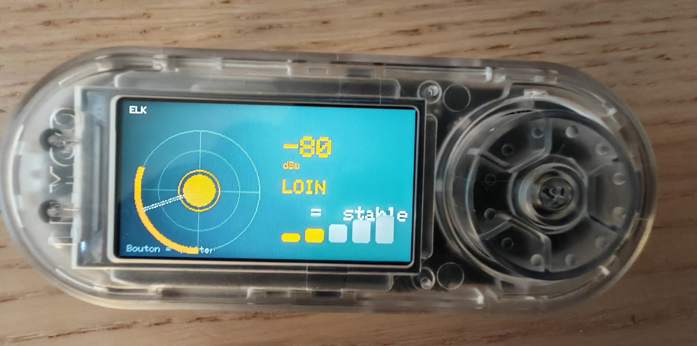
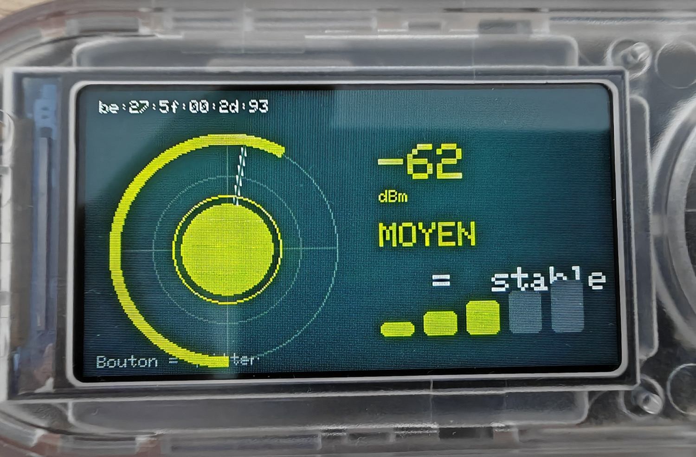
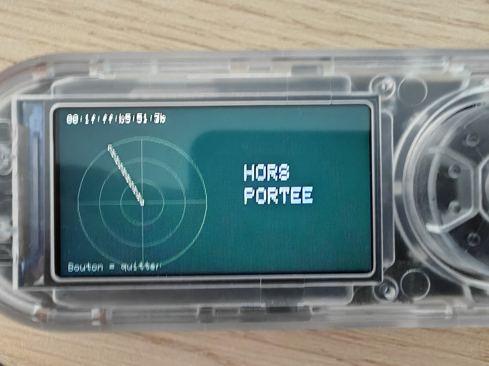
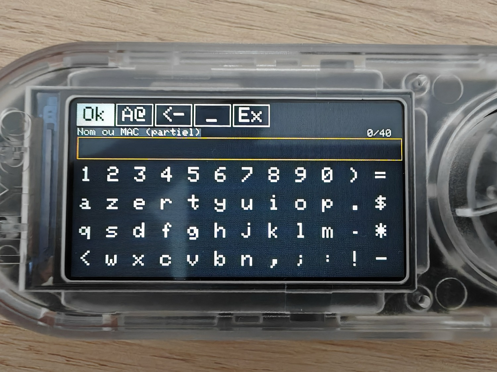

# 📡 BLE Finder — Bluetooth proximity tracker for Bruce

🇺🇸 <b>English</b> · 🇫🇷 <a href="README.fr.md">Français</a>

  

A **JavaScript** script for the **[Bruce](https://github.com/BruceDevices/firmware)** firmware (tested on the **LilyGO T-Embed CC1101**). It turns the device into a **BLE proximity radar**: pick a Bluetooth device, then the screen guides you like a metal detector — **the closer you get, the bigger the blip grows and the more it shifts from red to green**, with a **"HOTTER / COLDER"** hint at every step.

## ✨ Features

- **Two selection modes**:
  - **Full list** — scans and shows every BLE device (name + RSSI).
  - **Search (name / MAC)** — type **part** of a name or MAC address → filters the list → you pick. If it isn't there yet, choose **"wait for it to appear"**.
- **Sonar radar**: a filling ring gauge, a **central blip** whose size and color (red → yellow → green) reflect proximity, animated sweep.
- **Live dBm**, zone (`VERY CLOSE` … `VERY FAR`), **hotter/colder** arrow and **signal bars**.
- Stays in **"searching…"** while the target isn't picked up (handy when it goes out of range and comes back).

## 🖼️ Preview

| Radar (close) | Searching / out of range | Filter input |
|---|---|---|
|  |  |  |

## 🚀 Installation

1. Copy **`BLE Finder.js`** to the SD card, into a folder Bruce reads: **`/BruceJS`**, `/scripts` or `/BruceScripts`.
2. On the device: **JS Interpreter** → open `BLE Finder.js`.
3. Pick a mode, select your target and walk around: the blip heats up as you get closer.
4. **Back button / ESC** to quit.

## ⚙️ Settings (top of the script)

- `SCAN_SEC` — length of a tracking scan (default 1 s).
- `LO` / `HI` — RSSI range (far → close, default −100 → −35 dBm). Adjust to the real dBm values you see.

## 📝 Technical notes

- Feedback is **100% on screen**: on Bruce 1.15, audio (`audio.tone`) and the RGB LED **can't be driven in real time from a JS script** — the visual radar is the reliable option.
- Devices using a **random MAC** (AirPods, recent trackers) may "jump" when tracked by address; tracking by **name** is then more stable.
- The target has to be **advertising** to be detected.

## 🖥️ Compatibility

Built for the **LilyGO T-Embed CC1101** (320×170 screen) running **Bruce**. Should work on other Bruce targets with a color screen.

## 🛒 Hardware

*Amazon affiliate links: if you buy through these links, the project earns a small commission at no extra cost to you.*

<table>
<tr>
<td align="center" width="33%">
   
  <b><a href="https://www.amazon.com/dp/B0D45MSMJR?linkCode=ll2&amp;tag=koua29bblefinder-20&amp;ref_=as_li_ss_tl">Anker 545 power bank (10,000 mAh)</a></b> Keeps the T-Embed running away from an outlet
</td>
<td align="center" width="33%">
   
  <b><a href="https://www.amazon.com/dp/B0C1FCZM94?linkCode=ll2&amp;tag=koua29bblefinder-20&amp;ref_=as_li_ss_tl">433 MHz SMA antenna (2-pack)</a></b> Sub-GHz antenna for the CC1101 radio
</td>
<td align="center" width="33%">
   
  <b><a href="https://www.amazon.com/dp/B0B7NVMBPL?linkCode=ll2&amp;tag=koua29bblefinder-20&amp;ref_=as_li_ss_tl">SanDisk 64 GB microSD (2-pack)</a></b> For Bruce themes, scripts and captures
</td>
</tr>
</table>

As an Amazon Associate I earn from qualifying purchases.
</td>
<td align="center" width="33%">
   
  <b><a href="https://www.amazon.com/dp/B0C1FCZM94?linkCode=ll2&tag=koua29bblefinder-20&ref_=as_li_ss_tl">433 MHz SMA antenna (2-pack)</a></b> Sub-GHz antenna for the CC1101 radio
</td>
<td align="center" width="33%">
   
  <b><a href="https://www.amazon.com/dp/B0B7NVMBPL?linkCode=ll2&tag=koua29bblefinder-20&ref_=as_li_ss_tl">SanDisk 64 GB microSD (2-pack)</a></b> For Bruce themes, scripts and captures
</td>
</tr>
</table>

As an Amazon Associate I earn from qualifying purchases.

## ☕ Buy me a coffee

If you like this script:

## 📄 License

MIT — see [LICENSE](LICENSE). By **koua29**.
